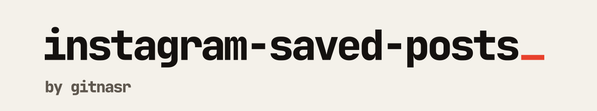

<picture>
  <source media="(prefers-color-scheme: dark)" srcset=".github/banner-dark.svg">
  
</picture>

Keep your Instagram saved posts. Search them, follow the accounts behind them, and still have them after a creator deletes a post or goes private. Self-hosted, one command to run.

[Quick start](#quick-start) ·
[Deploy on Dokploy or Coolify](#deploy-on-dokploy-or-coolify) ·
[Features](#features) ·
[Documentation](https://insta-saved.gitnasr.com/docs) ·
[Releases](https://github.com/gitnasr/Instagram-Saved-Posts/releases)

## Why

Instagram has no search and no archive for saved posts. When a creator deletes their account, changes handle, or makes a post private, the bookmark is gone with it.

This app syncs your saved posts into your own database: media, carousels, captions and account details. It also records what changes on those accounts, so you can see when a username changed or an account disappeared.

## Quick start

No clone and no `.env` file needed.

Linux and macOS:

```bash
curl -fsSL https://raw.githubusercontent.com/gitnasr/Instagram-Saved-Posts/master/install.sh | bash
```

Windows (PowerShell):

```powershell
irm https://raw.githubusercontent.com/gitnasr/Instagram-Saved-Posts/master/install.ps1 | iex
```

Docker Compose. Create a `docker-compose.yml` and start it:
```yaml
services:
  app:
    image: ghcr.io/gitnasr/instagram-saved-posts:latest
    pull_policy: always
    restart: unless-stopped
    ports:
      - "5050:3000"
    environment:
      - DATABASE_URL=mongodb://mongo:27017/instagram?replicaSet=rs0&directConnection=true
    depends_on:
      mongo:
        condition: service_healthy

  mongo:
    image: mongo:7.0
    restart: unless-stopped
    command: ["--replSet", "rs0", "--bind_ip_all", "--port", "27017"]
    volumes:
      - mongo_data:/data/db
    healthcheck:
      test: >
        mongosh --port 27017 --eval "
          try {
            rs.status().ok
          } catch (e) {
            rs.initiate({
              _id: 'rs0',
              members: [{ _id: 0, host: 'mongo:27017' }]
            }).ok
          }
        " || exit 1
      interval: 5s
      timeout: 5s
      retries: 10
      start_period: 2s

volumes:
  mongo_data:
```

```bash
docker compose up -d
```

Open `http://localhost:5050` and follow the setup wizard. It takes about a minute and asks for your Instagram session cookie ([how to get it](https://insta-saved.gitnasr.com/docs/getting-started/how-to-get-instagram-cookie)).

### Optional: vector search (beta)

Search by text description, by similar image, or by face. It is off by default: it adds a Qdrant service and downloads about 600 MB of model weights the first time you index. Everything else works without it.

```bash
docker compose -f docker-compose.yml -f docker-compose.search.yml up -d
```

Setup and trade-offs: [Vector search](https://insta-saved.gitnasr.com/docs/features/ai-vector-search). The compose file is [`docker-compose.search.yml`](docker-compose.search.yml).

## Deploy on Dokploy or Coolify

**Dokploy**

1. Create a project, then add a **Compose** service.
2. Paste the contents of [`dokploy-compose.yml`](dokploy-compose.yml).
3. Set your domain and deploy.

Full guide: [Dokploy](https://insta-saved.gitnasr.com/docs/deployment/dokploy).

**Coolify**

1. Add a new resource, then **Docker Compose**.
2. Paste the contents of [`coolify-compose.yml`](coolify-compose.yml).
3. Set your domain and deploy.

Full guide: [Coolify](https://insta-saved.gitnasr.com/docs/deployment/coolify).

## Features

| | |
| --- | --- |
| Continuous sync | Saved posts, carousel media, captions and account details, stored in your own MongoDB. |
| Multiple profiles | Several Instagram accounts side by side, each with its own session and its own bookmarks. |
| Account timelines | Username changes, bio edits, verification changes, and accounts that were deleted or went private. |
| Resumable scraper | Detects rate limits, backs off exponentially, and resumes from a checkpoint. |
| Permanent media | Optional Cloudinary sync, so media keeps loading after the Instagram CDN links expire. |
| Reverse proxy and SSO | Reads Authentik and Authelia headers, with a read-only viewer mode. |
| Setup wizard | Tests your session cookie live and previews the avatar before you save. |
| Vector search (beta, optional) | Text, similar-image and face search with Qdrant. Off by default. |

The UI has light and dark themes (Tailwind CSS 4, Radix UI).

## Versions and rollbacks

Releases are automatic. A push to `master` works out the version bump from the commits, tags it, publishes a [GitHub release](https://github.com/gitnasr/Instagram-Saved-Posts/releases) with notes, and pushes the image to GHCR. Documentation and CI-only changes do not publish a release.

Every tag stays on GHCR. To pin a version or roll back, replace `:latest` in your compose file:

```yaml
image: ghcr.io/gitnasr/instagram-saved-posts:v1.0.1
```

Pull requests build preview images tagged `beta-pr-<number>` and `beta`.

## Configuration

With Docker Compose no environment variables are required. Optional settings go in `.env`:

| Variable | Default | Description |
| :--- | :--- | :--- |
| `PORT` | `5050` | Host port for the web app |
| `QDRANT_URL` | unset | Setting this enables the beta vector search |
| `QDRANT_PORT` | `6335` | Host port for the Qdrant API and dashboard, used only with search enabled |
| `DATABASE_URL` | `mongodb://mongo:27017/instagram?replicaSet=rs0&directConnection=true` | MongoDB connection string (replica set required) |
| `CLOUDINARY_CLOUD_NAME` | `""` | Cloudinary cloud name, for permanent media |
| `CLOUDINARY_API_KEY` | `""` | Cloudinary API key |
| `CLOUDINARY_API_SECRET` | `""` | Cloudinary API secret |
| `LOG_LEVEL` | `info` | `info`, `debug`, `warn` or `error` |
| `DISABLE_UPDATE_CHECK` | unset | Set to `true` to turn off the in-app update check |

**Update check and privacy.** Settings shows when a newer release exists. To do that, the server sends one `GET` to `api.github.com` at most about once an hour, with a `User-Agent` of `instagram-saved-posts/<version>`, and nothing else: no telemetry, no identifiers, nothing from your data. Set `DISABLE_UPDATE_CHECK=true` to make no request at all. The app never updates itself. See [Updating](https://insta-saved.gitnasr.com/docs/operations/updating).

## Documentation

Everything else lives at [insta-saved.gitnasr.com/docs](https://insta-saved.gitnasr.com/docs):

[Instagram cookie](https://insta-saved.gitnasr.com/docs/getting-started/how-to-get-instagram-cookie) ·
[Docker Compose](https://insta-saved.gitnasr.com/docs/deployment/docker-compose) ·
[Dokploy](https://insta-saved.gitnasr.com/docs/deployment/dokploy) ·
[Coolify](https://insta-saved.gitnasr.com/docs/deployment/coolify) ·
[Reverse proxy and SSO](https://insta-saved.gitnasr.com/docs/deployment/reverse-proxy-and-sso) ·
[Cloudinary](https://insta-saved.gitnasr.com/docs/features/cloudinary-cdn) ·
[Backup and restore](https://insta-saved.gitnasr.com/docs/operations/backup-and-restore) ·
[Updating](https://insta-saved.gitnasr.com/docs/operations/updating) ·
[Troubleshooting](https://insta-saved.gitnasr.com/docs/operations/troubleshooting-faq)

## Local development

```bash
git clone https://github.com/gitnasr/Instagram-Saved-Posts.git
cd Instagram-Saved-Posts
npm install

# MongoDB with a replica set (Prisma transactions need it)
docker run -d -p 27017:27017 --name ig_mongo mongo:7.0 --replSet rs0
docker exec ig_mongo mongosh --eval "rs.initiate()"

export DATABASE_URL="mongodb://localhost:27017/instagram?replicaSet=rs0&directConnection=true"
npx prisma generate
npm run dev
```

## Contributing

Pull requests are welcome. Read [CONTRIBUTING.md](CONTRIBUTING.md) first.

## License

[MIT](LICENSE). Made by [gitnasr](https://gitnasr.com).
